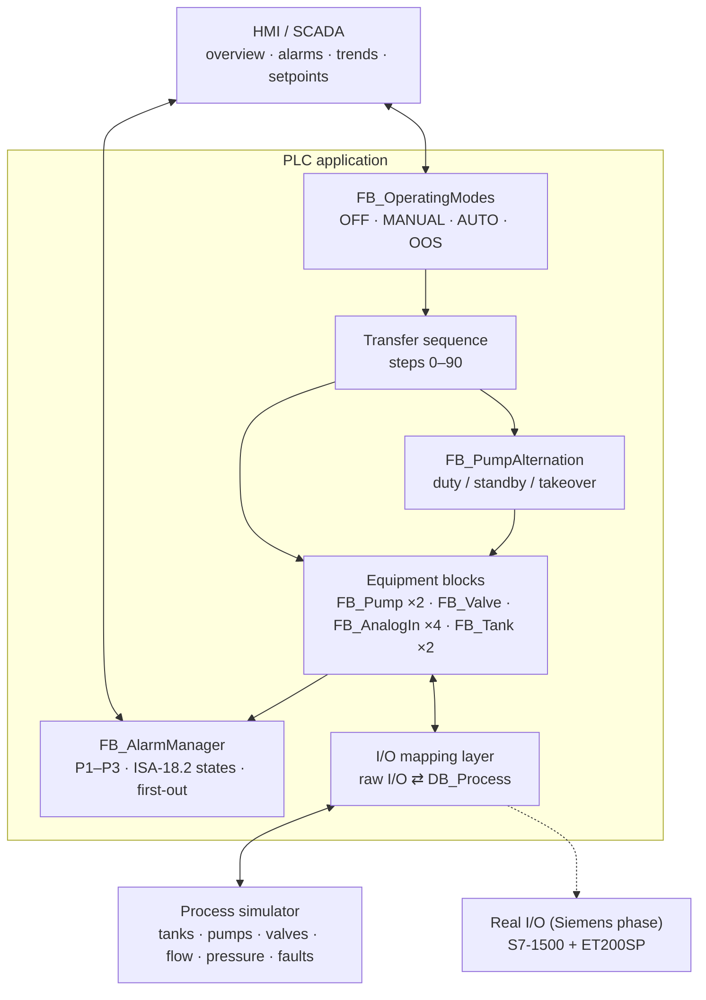
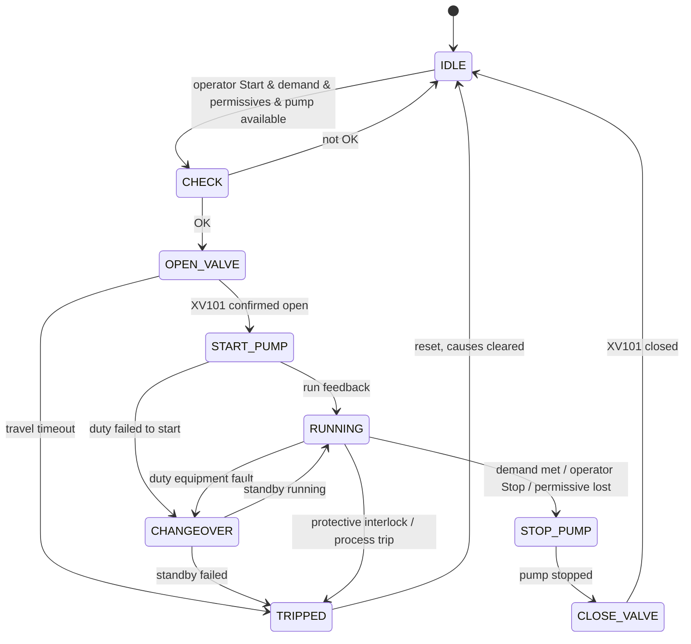

# Software Architecture

## Layers

Control logic never touches the simulator directly: everything passes through the mapping layer, so the same
blocks run unchanged on real I/O.

## Sequence

## Interlock classes

| Class | Applies in | Effect | Example |
|---|---|---|---|
| Protective interlock | All modes, not bypassable | Immediate stop, latched | Source low-low, leak, E-stop |
| Process permissive | AUTO | Stop at once, transfer resumes when restored | Remote permissive, reservoir level |
| Process trip | AUTO / MANUAL while running | Pump trip, station trip latched, no takeover | Dry run, high discharge pressure |
| Equipment fault | All modes | Pump fault, standby takeover in AUTO | Start failure, MCC trip |

## Platform mapping

| Concept | CODESYS (development) | Siemens (target) |
|---|---|---|
| Main cycle | `MainTask` → `PRG_Main` | OB1 |
| Startup | first-scan logic | OB100 |
| Equipment block | FB + instance | FB + instance DB / multi-instance |
| Global data | GVL `DB_Process` | Global DB `"DB_Process"` |
| Sequence / alarms | ST | SCL |
| Interlocks | ST / LD | LAD |
| HMI | CODESYS Visualization | WinCC |
